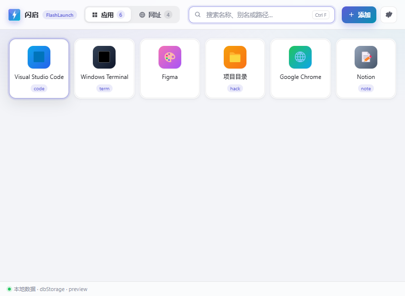

# 闪启 FlashLaunch

**常用资源，一键直达。**

在 ZTools 中集中管理常用软件、文件、文件夹和网址：拖拽添加、起个别名、搜索框直接启动，不用再一层层翻开始菜单或资源管理器。



## 功能

| 功能 | 说明 |
|---|---|
| 快捷启动 | 打开应用、文件、文件夹和网址 |
| 别名直达 | 为项目设置别名，在 ZTools 搜索框直接启动 |
| 拖拽添加 | 文件、文件夹、快捷方式、链接拖入面板 |
| 快速搜索 | 按名称、别名或路径过滤 |
| 智能图标 | 读取程序图标、图片图标和网站 favicon |
| 高级启动 | 自定义参数、备用路径、Windows 管理员启动 |
| 卡片操作 | 右键打开、编辑、定位、复制路径、删除 |
| 个性设置 | 图标大小、隐藏名称、启动后退出 |
| 数据管理 | 本地存储，支持 JSON 导出与导入 |

### 暂未实现

分类管理、批量启动、插件面板、文件夹映射与内置文件管理器、浏览器书签同步、内置浏览器、贴边磁贴、侧边栏。这些不在当前版本的宣传范围内。

## 使用

- **打开面板**：输入 `闪启`、`flashlaunch` 或 `fl`；也可以用 `闪启应用` / `闪启网址` 直接进入对应面板。
- **新增**：右上角「添加」→ 应用 / 文件夹 / 网址；也可以把文件、快捷方式、浏览器链接拖进窗口。
- **别名直达**：编辑卡片填「别名」（例如 `code`），之后在 ZTools 主输入框直接输入 `code` 即可启动，不必先打开面板。
- **网址搜索**：地址写成 `https://www.baidu.com/s?wd={query}`，点击卡片时会先询问关键词。
- **搜索**：输入名称 / 别名 / 路径片段；`Ctrl+F` 聚焦，`Esc` 清空。
- **设置**：图标大小、隐藏名称、启动后是否退出插件，以及 JSON 备份 / 恢复。

> 首次安装后先打开一次面板，让已配置的别名注册到 ZTools。别名依赖动态 feature，插件被禁用或卸载后会随之失效。

## 数据

- 卡片：`fl.apps`、`fl.webs`；设置：`fl.settings`；已注册别名：`fl.featureCodes`。
- 全部保存在 ZTools 提供的插件级 `dbStorage` 中，不写系统目录。
- 设置 → 导出备份生成 `闪启-备份-*.json`；导入会整体覆盖当前数据。

## 安全

- 启动不经过 shell 字符串拼接：
  - 普通启动使用 `spawn(可执行文件, 参数数组)`，不经过 shell；
  - Windows 管理员启动使用 PowerShell `-EncodedCommand`，路径与参数以单引号字面量传入；
  - 解析 `.lnk` 的兜底命令通过环境变量传路径，不拼接文件路径。
- 启动参数由 `utils/args.js` 拆分，支持引号与转义，不交给 shell 解析。
- 抓网页只读取 `<head>` 中的标题与 icon，不执行页面脚本。
- 没有联网上报、没有遥测，不访问除用户点击卡片以外的任何地址。

## 兼容性

- 当前只声明 Windows（`platform: ["win32"]`），因为开发与验证环境是 Windows + ZTools。
- 代码里保留了 macOS `open`、Linux `.desktop` / `.sh` 的分支，但尚未实机验证，所以暂不对外声明支持。

## 已知限制

- 单纯依赖路径与系统图标，不扫描开始菜单；需要用户添加或拖入。
- 没有分类和批量启动，卡片多时依靠搜索定位。
- 数据为单机存储，没有跨设备同步。

## 目录

```text
flashlaunch/
├─ plugin.json      ZTools 清单
├─ index.html       主界面
├─ preload.js       图标 / 快捷方式 / 启动 / 抓网页 / 备份
├─ utils/args.js    启动参数解析
├─ assets/
│  ├─ app.js        界面与状态
│  └─ styles.css    亮 / 暗色主题
└─ docs/            截图
```
