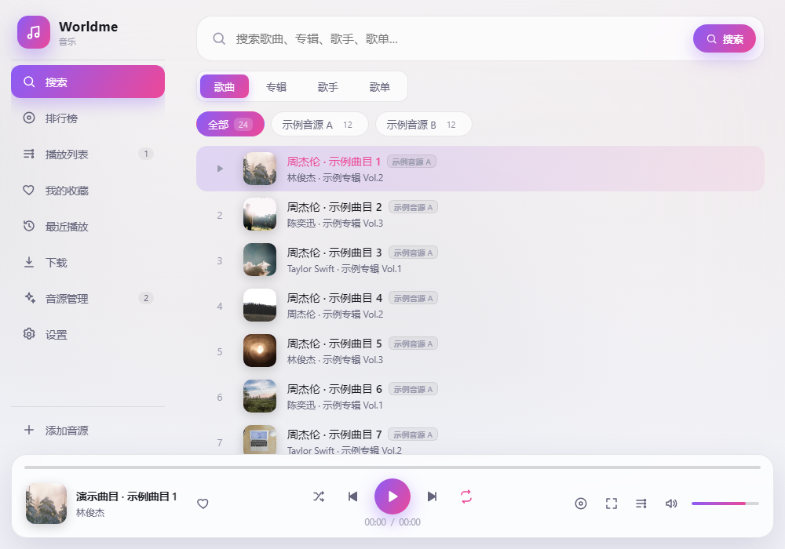
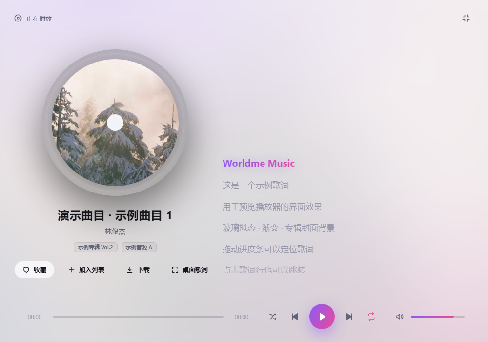
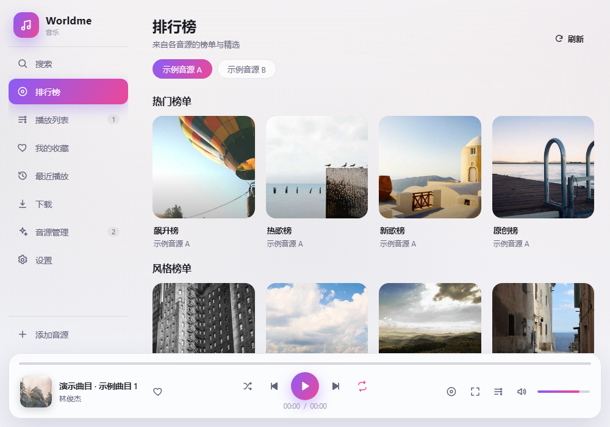
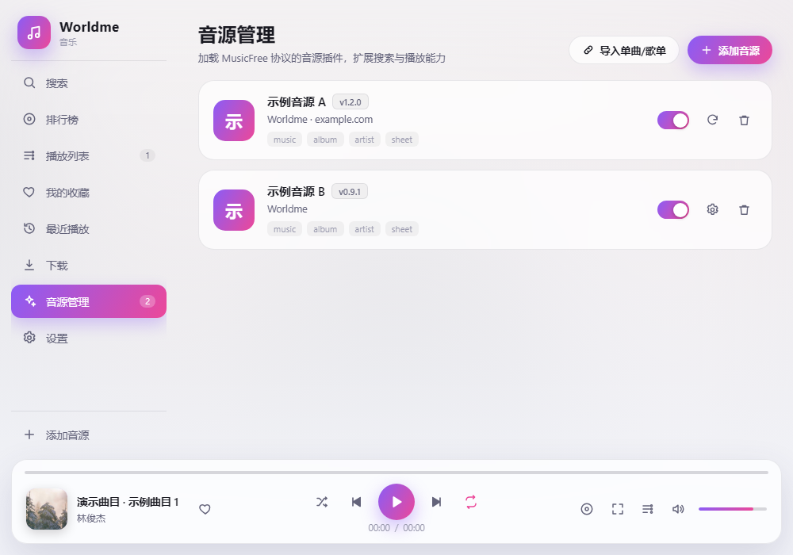

# 🎵 Worldme 音乐

> **插件化 · 可定制 · 无广告的 ZTools 音乐播放器**

Worldme 音乐本身不内置任何音源。加载兼容 **MusicFree 协议** 的音源插件后，即可在 ZTools 中搜索、播放、下载音乐，并享受逐行歌词与桌面歌词。

无论你只有一个音源，还是想同时聚合多个来源，它都能作为一个干净、漂亮、顺手的播放器存在。

---

## 📸 界面预览

| 聚合搜索 | 正在播放 |
| --- | --- |
|  |  |

| 排行榜 | 音源管理 |
| --- | --- |
|  |  |

> 截图为开发预览（内置示例音源与示例数据），实际内容取决于你加载的音源。

---


## ✨ 为什么选择 Worldme 音乐

| | 特色 | 说明 |
|---|---|---|
| 🧩 | **音源自由** | 播放器不捆绑音源。链接、订阅、本地文件、粘贴代码，四种方式随时添加 |
| 🔍 | **多源聚合搜索** | 一次输入，同时检索所有已启用音源；支持歌曲 / 专辑 / 歌手 / 歌单 |
| 💿 | **完整详情页** | 专辑与歌单曲目、歌手单曲与专辑、排行榜详情，分页加载不卡顿 |
| 🎧 | **沉浸式播放** | 播放队列、循环 / 单曲 / 随机、音量、进度拖动、多档音质自动回退 |
| 📄 | **双语滚动歌词** | 原文 + 翻译逐行高亮，点击歌词行即可跳转 |
| 🖥️ | **桌面歌词** | 独立置顶窗口，可拖动、可调字号，跟随播放实时滚动 |
| ⬇️ | **离线下载** | 自动选择可用音质，实时进度，完成后可直接打开所在文件夹 |
| 📥 | **随心导入** | 通过音源解析链接或 ID，导入单曲 / 歌单，一键播放、加入列表或收藏 |
| ❤️ | **本地曲库** | 我的收藏、最近播放，随时找回听过的歌 |
| 🎨 | **沉浸式界面** | 专辑封面环境光、旋转唱片、玻璃拟态与渐变主题，深浅色随 ZTools 联动 |
| 🌐 | **网络友好** | 自动读取系统代理；GitHub Raw / jsDelivr 失败时自动尝试镜像并重试 |
| 🔒 | **数据留在本地** | 基于 ZTools 数据库存储，支持官方数据同步，不上传个人信息 |

---

## 🚀 快速上手

### 1. 安装插件

在 ZTools 插件中心安装 **Worldme 音乐**（或加载构建后的插件目录）。

### 2. 准备音源

音源需为符合 **MusicFree 插件协议** 的 `.js` 单文件，或包含 `plugins` 列表的订阅 `.json`。
> 本插件不提供、不内置任何音源，请自行准备并仅使用可信来源。

### 3. 添加音源

打开插件 → 左侧「音源管理」→「添加音源」，支持：

- 🔗 **链接安装**：粘贴音源 `.js` 直链
- ☁️ **订阅导入**：粘贴 `plugins.json` 订阅地址，解析后可勾选音源、查看安装进度，失败项支持重试
- 📁 **本地文件**：选择本地的 `.js` / `.json`
- 📝 **粘贴代码**：直接粘贴音源代码（安装前请确认来源可信）

安装后可在音源卡片上启用 / 停用、更新、卸载，或配置音源要求的参数（Cookie、Token 等）。

### 网络与代理

如果所在网络无法直接访问 GitHub / jsDelivr，可在「设置 → 网络」中选择「自动」读取系统代理，或手动填写代理地址（如 `http://127.0.0.1:7890`）。镜像回退默认开启，失败时也会自动重试。

### 4. 开始听歌

在 ZTools 主输入框输入：

```
音乐
music
播放器
听歌
worldme
```

或直接输入 **`音乐 关键词`**（如 `音乐 周杰伦`）打开并自动搜索。

---

## 🎧 功能详解

### 搜索与浏览
- 顶部切换 **歌曲 / 专辑 / 歌手 / 歌单** 四种类型
- 结果按音源分 Tab 展示，也可以「全部」混合查看
- 专辑、歌单、歌手、榜单均可进入详情页，支持分页加载

### 播放器
- 底部播放条：封面、进度、上一首 / 下一首、播放模式、音量
- 点击封面进入全屏播放页：大封面、旋转唱片、滚动歌词
- 音质自动回退：当前音质不可用时自动尝试其它音质
- 支持 HLS（`.m3u8`）流媒体播放

### 桌面歌词
- 播放条或全屏播放页点击「桌面歌词」
- 独立置顶窗口，无边框、可拖动、可调节字号
- 实时显示当前歌词、翻译与播放进度

### 下载
- 歌曲行、全屏播放页均可点击下载
- 自动按音质顺序尝试可用音源
- 「下载」页查看进度、完成状态，并可打开所在文件夹

### 导入
- 「音源管理 → 导入单曲/歌单」
- 选择音源与导入类型，粘贴链接或 ID
- 解析结果支持播放、加入列表、批量收藏

---

## 🧩 音源兼容性

Worldme 音乐的音源运行时与 MusicFree 保持一致，内置以下 npm 包，音源无需自行打包：

`axios` · `cheerio` · `crypto-js` · `dayjs` · `big-integer` · `qs` · `he` · `webdav`
以及 `@react-native-cookies/cookies` 与 `musicfree/storage` 的兼容实现。

支持的音源能力：

- `search`（歌曲 / 专辑 / 歌手 / 歌单）
- `getMediaSource`、`getMusicInfo`、`getLyric`
- `getAlbumInfo`、`getMusicSheetInfo`、`getArtistWorks`
- `getTopLists`、`getTopListDetail`
- `importMusicItem`、`importMusicSheet`
- `platform`、`version`、`srcUrl`、`primaryKey`、`cacheControl`、`userVariables`、`hints`

---

## ❓ 常见问题

**Q：搜索没有结果？**
先确认音源已启用，并检查音源是否支持当前搜索类型（歌曲 / 专辑 / 歌手 / 歌单）；部分音源需要先在「音源管理」中配置参数。

**Q：歌曲无法播放？**
可能是音源链接失效、需要登录参数或存在地区限制。播放器会自动尝试其它音质，仍失败时会跳过当前歌曲。

**Q：为什么没有歌词？**
歌词由音源提供。并非所有音源、所有歌曲都有歌词；纯音乐通常没有。

**Q：下载失败？**
可能是音源未返回可用的下载地址，或网络受限。可尝试切换音质或更换音源。

**Q：导入订阅或 GitHub 音源时报 `ECONNRESET`？**
通常是网络无法直连 GitHub / jsDelivr。请在「设置 → 网络」使用「自动」代理，或手动填写代理地址；镜像回退默认开启。

**Q：提示音源文件存在语法错误？**
说明该音源自身的 JS 代码有误（例如重复声明变量），任何播放器都无法加载。请更换可用音源，或等待作者修复。

**Q：数据会同步吗？**
是的。音源、设置、收藏与播放记录保存在 ZTools 数据库中，可随 ZTools 官方数据同步；插件不会上传个人信息。

---

## ⚠️ 免责声明

- 本插件**不内置、不提供**任何音源内容，所有搜索结果、播放链接与下载内容均来自用户自行加载的第三方音源。
- 请**仅加载可信来源**，自行承担使用第三方音源带来的风险。
- 请遵守相关法律法规与各平台服务条款，**不要用于任何商业用途**，不要用于获取或传播侵权内容。
- 因使用第三方音源产生的一切后果由使用者自行承担。

---

## 🤖 关于代码

本项目的代码由 **AI 辅助生成**（包括架构设计、界面实现与部分文档），并经过人工审查、联调与真实音源测试。欢迎反馈问题与改进建议。
